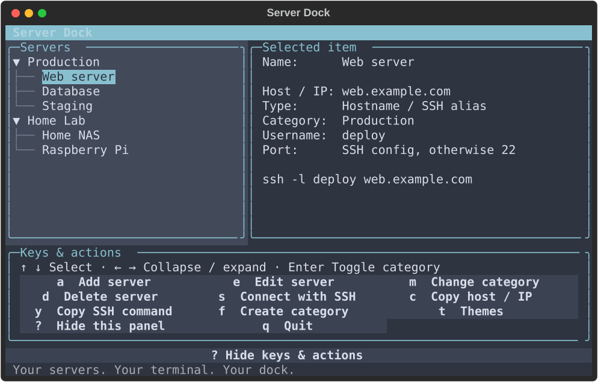
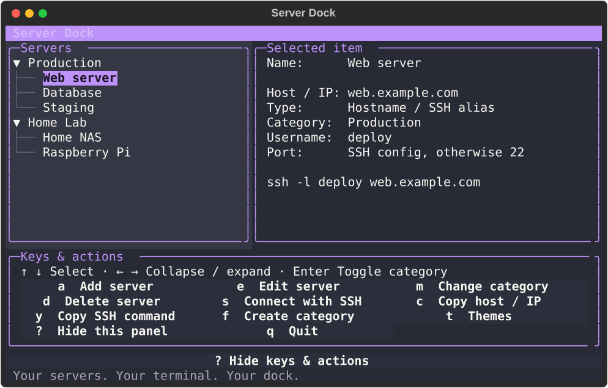
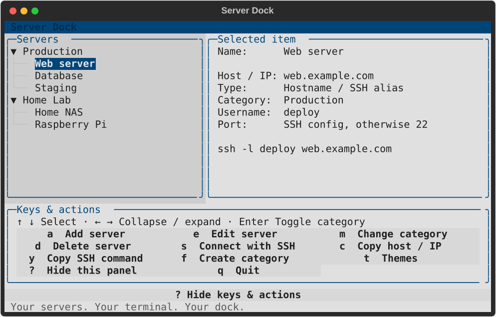

# Server Dock

A keyboard-first SSH address book for macOS. Group your hosts, pick a server,
and press `s` to connect using the SSH config and keys you already have.

**Under 1,000 lines of application code** in [one Python file](server_dock.py),
built with [Textual](https://textual.textualize.io/).


## Install

Requires **Python 3.10+**, macOS, and your usual SSH setup.
Install with [uv](https://docs.astral.sh/uv/getting-started/installation/):

```sh
uv tool install git+https://github.com/kaanmertkoc/server-dock
server-dock
```

From a checkout, `uv tool install .` or `pipx install .` also works.
To update, repeat the install command with `--reinstall`; check your build with
`server-dock --version`. The [Finder launcher](Server%20Dock.command) opens it in Terminal.

## Make it yours

Press **`t`** to browse themes. Your choice is saved for the next launch.
Pick a built-in theme or define your own palette in `themes.json`.

| Nord | Dracula | Textual Light |
| :---: | :---: | :---: |
|  |  |  |

Give your dock a name, too:

```sh
server-dock --name "Kaan's Dock"
```

The name is remembered; the command stays `server-dock`. Existing Kaan's Dock
users keep their data and preferences—launch `server-dock` to use this version.

## Use

| Key | Action |
| --- | --- |
| ↑ / ↓ | Select a server or category |
| ← / →, Enter | Collapse or expand categories |
| `a` / `e` / `d` | Add, edit, or delete a server |
| `s` | Connect with SSH; disconnect to return |
| `c` / `y` | Copy the address or SSH command |
| `f` / `m` / `r` | Create a category, move a server, or rename a category |
| `t` | Choose and remember a theme |
| `?` / `q` | Toggle help or quit |

Add an IP address, hostname, or alias from `~/.ssh/config`. Leave username and
port blank to use your SSH defaults. In forms: Tab or ↑ / ↓ to navigate,
Ctrl+S to save, Esc to cancel. An 80×24 or larger terminal is recommended.

## Local configuration

Everything lives in `~/.config/server-dock/`:

- `servers.json` — servers and categories
- `settings.json` — your dock's display name
- `themes.json` — saved theme and custom palettes; restart after editing palettes

Override paths with `--data`, `--settings`, or `--themes`. Existing
`~/.config/kaans-dock/` server and theme files are used when the new files don't
exist; migration never moves or overwrites them.

Uses your installed `ssh`, stores no passwords or keys, and saves changes atomically.
Clipboard uses macOS `pbcopy`. Use one running instance per address book.

## Development

```sh
python3 -m venv .venv
source .venv/bin/activate
python -m pip install -e .
python -m unittest -v
server-dock --data examples/servers.json --settings /tmp/server-dock-demo-settings.json
```

Build with `uv build`; refresh screenshots with `python docs/capture_screenshots.py`.
Screenshots use fictional servers and temporary settings. Contributions are welcome.

## License

[MIT](LICENSE) © 2026 Kaan.
