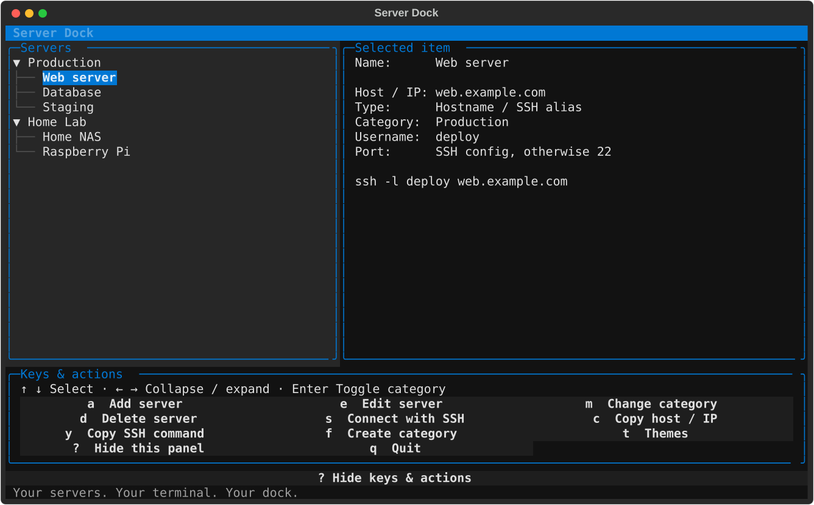
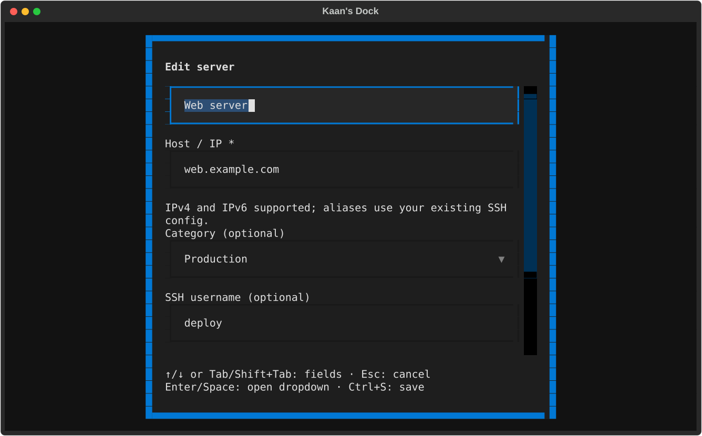

# Server Dock

A small SSH address book for your terminal. Group your servers, find a host,
and connect with a keystroke. Built with Python and [Textual](https://textual.textualize.io/).



## Install

Requires **Python 3.10+**, macOS, and your usual SSH setup.

From this repository, install with [uv](https://docs.astral.sh/uv/getting-started/installation/):

```sh
uv tool install .
server-dock
```

Or use `pipx install .`. Both install an isolated terminal command that works
from any directory. Update from a newer checkout with `uv tool install --reinstall .`.
Check the installed build with `server-dock --version`. If you used Kaan's Dock,
launch `server-dock` now; the old `kaans-dock` command runs a separate installation.

After installing, you can also double-click **Server Dock.command** in Finder
to open it in Terminal. Move that launcher wherever is convenient.

## Make it yours

The command is always `server-dock`; the name inside the app is yours to choose:

```sh
server-dock --name "Kaan's Dock"
```

The name is saved for future launches. New installations start as **Server Dock**.
Existing Kaan's Dock users keep their address book, themes, and display name.



## Use

| Key | Action |
| --- | --- |
| ↑ / ↓ | Select a server or category |
| ← / →, Enter | Collapse or expand categories |
| `a` / `e` / `d` | Add, edit, or delete a server |
| `s` | Connect with SSH; disconnect to return |
| `c` / `y` | Copy the address or SSH command |
| `f` / `m` / `r` | Create a category, move a server, or rename a category |
| `t` | Choose and remember a theme |
| `?` / `q` | Toggle help or quit |

Add an IP address, hostname, or alias from `~/.ssh/config`. Leave username and
port blank to use your SSH defaults. In forms, use Tab or ↑ / ↓ to navigate,
Ctrl+S to save, and Esc to cancel. An 80×24 or larger terminal is recommended.

## Local configuration

Your address book and preferences live in `~/.config/server-dock/`:

- `servers.json` — servers and categories
- `settings.json` — your dock's display name
- `themes.json` — saved theme choice and custom palettes; choosing a theme saves it
  automatically for future launches. You can also edit palettes here and restart.

Override individual files with `--data`, `--settings`, or `--themes`.
Existing `~/.config/kaans-dock/` server and theme files are used when the new
files do not exist; they are never moved or overwritten during migration.

Server Dock stores no passwords or SSH keys. It uses your installed `ssh`
client and saves changes atomically. Clipboard shortcuts currently use macOS
`pbcopy`. Use one running instance per address book.

## Development

```sh
python3 -m venv .venv
source .venv/bin/activate
python -m pip install -e .
python -m unittest -v
server-dock --data examples/servers.json --settings /tmp/server-dock-demo-settings.json
```

Build a wheel and source distribution with `uv build`. Screenshots use fictional
servers and can be regenerated with `python docs/capture_screenshots.py`.
Issues and pull requests are welcome.

## License

[MIT](LICENSE) © 2026 Kaan.
